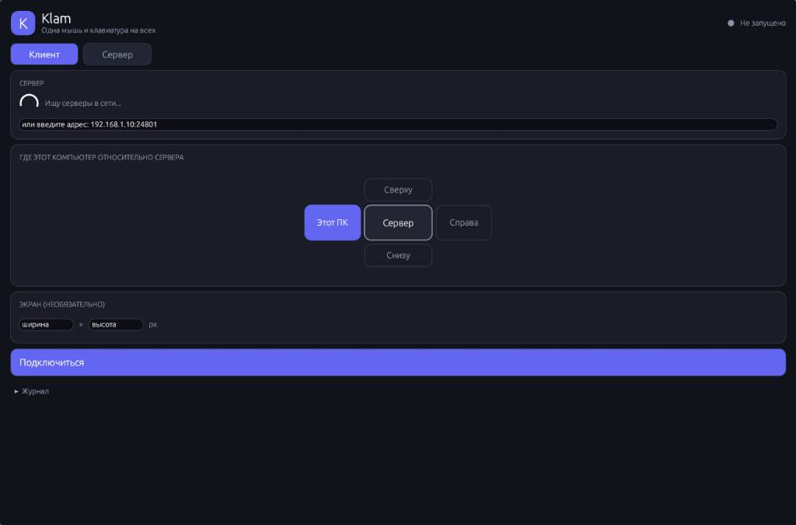
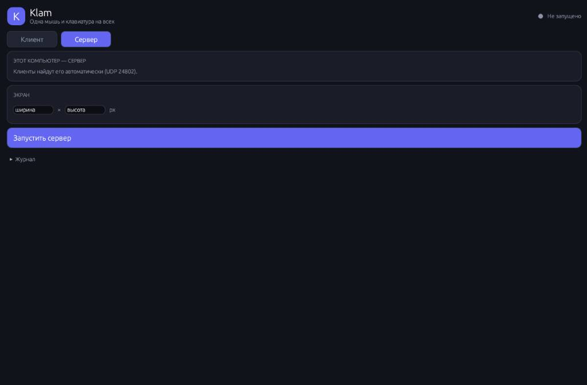

<h1>Klam — Ultra-low latency, cross-platform KVM sharing engine</h1>

Klam — это легковесный, высокопроизводительный KVM-композитор с открытым исходным кодом, написанный на чистом Rust. 
Проект позволяет бесшовно использовать один комплект клавиатуры, мыши и буфера обмена для управления несколькими физическими компьютерами (Linux и Windows) по локальной сети, избавляя от необходимости использовать аппаратные переключатели.

> [!WARNING]
> Используйте только в проверенных сетях! Никакой криптографической защиты нет!!!

